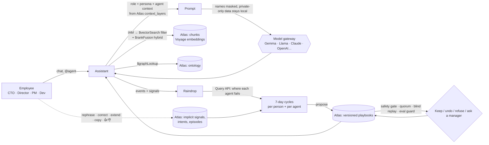
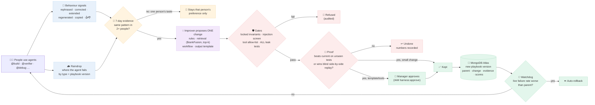
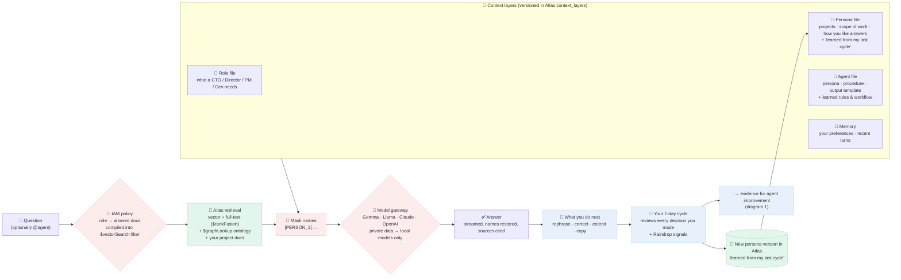

# Omniq Atlas

**Every person gets a team of agents that makes them 10×, and the team gets better every week by watching how they work.**

A developer works with Build, Verifier, Debug, Release and Code Review agents. A PM has Spec, Prioritization, Research,
Launch and Metrics. A director gets their own five plus every agent below them (15), and the CTO gets all 20. You @-hand off
a job, they do it in *your* context (role, persona, projects, access), and every agent improves itself over time from how
people actually use it: rephrasing, corrections, follow-ups, Raindrop's failure signals. A change is kept only when the data
proves it better, on unseen tests and blind replays, with zero leaks. The agents can tune themselves, but they can never
unlock themselves: IAM policy compiled into `$vectorSearch` means MongoDB itself enforces who sees what.

**Live:** https://omniq-mv4a4zfo47x-prod.cloud.modelence.app · **Results:** [docs/RESULTS.md](docs/RESULTS.md) (generated from Atlas) ·
**Demo script:** [DEMO.md](DEMO.md) · **End-to-end:** `scripts/e2e_live.py` (29/29)



## Flowcharts: agent improvement and context improvement

Also full-screen at `/workflow` in the running app (for demos).

**1 · Agent improvement (each of the 20 agents)**



**2 · Context improvement (each person, and what the model receives)**



## In plain English

Omniq is an AI assistant for everyone in a company. Each person only ever sees the documents their job allows,
and names and contact details are masked before the AI model sees anything.

The company has **four roles in a hierarchy: CTO → Directors → Product Managers and Developers**. Each role has
**5 prebuilt agents** (20 in all). Higher roles also get the agents of the roles below: a Director has 15, the CTO all 20.
Each agent is **one Markdown context file** (`data/agents/<role>/<agent>.md`). The file holds its LLM connection (model,
temperature, max tokens) and a context layer (persona, mission, priorities, recent events, working style, house rules,
output format, glossary), and the model receives it verbatim.

Every agent and access level follows a **playbook**: how many documents to read, which rules to follow, when to say "I don't know".
Each version of every playbook is saved in **MongoDB Atlas**, and the playbooks **improve themselves**:

1. **Test.** Practice questions with known answers give each playbook a score.
2. **Find the mistake.** For each wrong answer it asks: did it never find the right document, or did it find it and miss the fact?
3. **Try a fix.** An AI "improver" suggests one change, such as "read 5 documents instead of 2" or a new rule.
4. **Keep it only if it's proven better** on questions it has never seen, with zero privacy leaks. Otherwise the change is undone.
5. **Learn from people.** A 👎 with "do this instead" changes *your* answers right away. When two or more people ask
   for the same thing, the agent tries it for everyone, and keeps it only if a blind side-by-side comparison says it's better.

**What it can never do.** It can't turn off access rules, privacy masking or the audit log.
- Suggestions that try to get around the rules are set aside.
- Big changes (new tools, dropped rules) wait for a manager's approval.
- After three failed attempts in a row it pauses itself.
- If real users dislike a new version, it automatically switches back to the old one.

**Try it:** https://omniq-mv4a4zfo47x-prod.cloud.modelence.app
- Pick a person.
- Ask the agent something.
- Press **Improve itself ▶** and watch it test, fix and decide, in plain sentences.

## The problem

Enterprise assistants are tuned by hand. Someone edits the prompt, retrieval settings and guardrails for
each team, then hopes nothing regresses. Nobody wants an agent that tunes *itself*, because it could
also loosen its own access controls.

Omniq Atlas splits the harness into two parts:

- **Tunable:** rules, retrieval and context policy, tools and output guardrails. These are versioned
  per role in Atlas and evolve from hard eval scores and employee feedback.
- **Locked invariants:** ACL pre-filtering inside `$vectorSearch`, PII tokenization, the outbound leak
  guard and the hash-chained audit log. A patch that touches these is **blocked** and recorded.

## How a request works

```
employee ─► JWT ─► active harness for their role (Atlas `harness`)
         ─► $vectorSearch with the ACL as a pre-filter  (+ Voyage rerank, + $graphLookup ontology,
            + adopted lessons, + personal memories, as the harness allows)
         ─► PII → [PERSON_1] tokens ─► outbound guard ─► Claude ─► de-tokenize
         ─► episode (Atlas) + hash-chained audit (Atlas) + Raindrop event
```

## It learns from behaviour, not from asking (implicit signals)

Users are never asked for suggestions and never shown recommendation lists. The system watches how people actually work,
and every signal is logged in Atlas (`implicit_signals`, `improvement_requests`) and sent to Raindrop:

| Signal | Meaning | How it's detected |
|---|---|---|
| rephrased | the last answer missed | the next question is semantically the same (Voyage cosine ≥ 0.6, calibrated: rephrasings 0.67–0.75, unrelated 0.12–0.24) |
| followup_correction | the last answer missed something specific | "shorter", "add the owners", "that's wrong"… right after an answer |
| regenerated | not good enough | ↻ |
| copied | useful | copying the answer's text |
| 👍 / 👎 | explicit, one click | optional |

The 7-day cycles (per person and per agent) turn these patterns into what each person needs and which agents fall short,
then the governed loop decides what changes for everyone: the same pattern must show up for 2+ people, win a blind replay,
pass the eval guard and leak nothing.

## Every improvement request is logged and drives development

Each request is stored in `improvement_requests` against the exact answer and playbook version it was about, whichever
way it arrives: **✨ Improve** on an answer, a follow-up like "make it shorter / add the owners" (detected automatically),
or 👎 with "do this instead". It applies to that person immediately (preference memory), joins the agent's development log
(My agents → Updates), goes to Raindrop as an `improvement_request` signal, and feeds the agent's 7-day cycle and the governed
loop that changes the agent for everyone.

## IAM: role-based access control (`data/iam/policies.yaml`, `omniq_atlas/iam.py`)

Access follows AWS-IAM-style policies: **explicit Deny > Allow > implicit deny**. Roles inherit statements
(`cto → director → developer | product_manager → employee`), and variables expand per person:
`doc:hr/${user.manages}` means "HR notes for the teams I manage" and `project:${user.projects}` means "my projects".

- **Documents:** for org members, read access is *compiled from the policies* into the categories and HR teams that
  become the `$vectorSearch` pre-filter, so MongoDB enforces exactly what the policy says.
- **Actions:** `agent:use` (who can @ an agent), `improve:run` (directors improve Developer, PM and Director playbooks;
  the CTO improves all), `harness:approve|freeze|rollback`, `memory:delete` (own only). `iam:edit` and
  `harness:edit-invariants` are explicitly denied to everyone, including the CTO.
- **🔐 Access tab:** your role chain, variables, compiled access, every statement, your projects, and a simulator that
  answers "would X on Y be allowed?" and names the statement that decided it.

## Projects and scope of work (`data/projects.yaml`)

Eight projects, each with an owner, status, milestones, linked docs and **each member's own role and scope**
(for example, Maya is tech lead on ADR-007 and backend engineer on SSO/SAML). Every person's context file
includes "My projects and scope of work". Retrieval adds the most relevant passages from the asker's project docs
(still access-checked). Questions about yourself ("what should I focus on?") are searched with your project names.

## Governance of the autonomous cycle (`omniq_atlas/governance.py`)

Both loops end in one function, `governance.decide()`.

| Layer | Guard |
|---|---|
| Inputs | Injection screening at intake (flagged recommendations are quarantined); a 2-user quorum before any agent-wide change; 10 recommendations per user per agent per day |
| Changes | Validator (locked invariants, bounds, per-agent tool allow-list, rule caps), knob type checks, LLM safety review of new rule text |
| Promotion | Must beat the parent on evidence (holdout, or blind replay plus eval guard) **and** pass an absolute safety gate: every leak case for the audience |
| Risk | Tool changes, dropped rules and output-budget blowups go to `awaiting_approval` for an admin or executive |
| Runtime | One run per scope (TTL lock), 6 runs per hour, auto-pause for 30 min after 3 failed candidates, freeze switch, manual rollback, crash recovery, live watchdog |
| Record | Every proposal, block, quarantine, approval, rollback and pause goes into the hash-chained audit log |

## How the harness evolves (`omniq_atlas/evolve.py`)

1. Score the active harness for a role on the **train** split of `data/evals.yaml`. Each case is an
   answer, leak or abstain case, graded with exact checks. A leak costs extra.
2. Gather evidence: failing cases, employee 👎 (also sent to **Raindrop** as signals), similar past failures
   and lessons recalled with **Atlas Vector Search** (episodic and procedural memory).
3. A Claude meta-agent proposes **one** patch, for example `{"retrieval": {"rerank": true, "top_k": 6}}`.
4. The validator rejects anything that touches invariants, removes guardrails or adds tools outside the allow-list.
5. The candidate runs on train **and holdout**. It's promoted only if it wins with no new leaks.
   Otherwise it's rolled back. Either way the outcome becomes a lesson.
6. Every step is appended to an `evolve_runs` document, which **checkpoints** the run (`oa evolve --resume <id>`).
   The UI streams it live through a **MongoDB change stream**.

## Role-specific agents that keep improving from their users (`agents.py`, `memory.py`, `improve.py`)

| Role (rank) | Agents |
|---|---|
| **Developer** (1) | Code Review Buddy, On-call Copilot, Deploy Guide, Architecture Explainer, API Spec Helper |
| **Product Manager** (1) | PRD Writer, Roadmap Planner, Customer Voice, Launch Checklist, Metrics Analyst |
| **Director** (2) | Team Pulse, Incident Review, Capacity Planner, OKR Tracker, Delivery Risk Radar |
| **CTO** (3) | Tech Strategy Brief, Board Tech Brief, Reliability Scorecard, Build vs Buy Advisor, Security Posture |

Org roles come from the directory: engineers → Developer, the product team → Product Manager, engineering and product
managers → Director, the CTO → CTO. An org role only decides which agents a person can use. What each agent can read
is still that person's ACL. `scripts/build_agents.py` regenerates the context files deterministically
(seed = agent id), and a test ensures no context file contains restricted facts.
Each agent has:

- **its own harness lineage** (`agent:<id>`), seeded from the template's persona, focus categories and tool allow-list.
  The persona and allow-list are fixed identity; the evolver can only add rules and tune knobs.
- **its own context policy**: retrieval searches the agent's focus categories first, intersected with the user's
  grants (focus can narrow access, never widen it), then fills from everything else the user may read.
- **its own memory layer** in Atlas Vector Search (`agent_memory`):
  - *preferences* (per user) apply to that user's next answer immediately
  - *lessons* (agent-wide) come from adopted improvements and are opt-in per harness version
  - *facts* come from `/remember`
  - recent *conversation turns* give follow-ups their context
  Users can view and delete their own memories, never anyone else's or the agent's lessons.

**The recurring improvement loop.** A 👎 asks "what should it do differently next time?"

1. The recommendation becomes the user's preference right away, and is queued in `recommendations`.
2. When an agent has 2+ pending, the scheduler, which runs every minute, starts `improve.run`:
   - groups the recommendations into themes by Voyage similarity
   - the meta-agent triages each theme as *personal* (already handled by that user's memory) or *agent-wide*
   - it drafts one patch; the validator checks it, with one self-repair attempt if it objects
3. The candidate is tested two ways:
   - a **blind, order-randomized LLM-judge replay** of the recommended questions, *with personal memory off*,
     to test whether the change helps every user
   - the **agent's graded eval guard**: no score regression, no new leaks
4. It's promoted (the theme becomes an agent-wide lesson) or rolled back.

**Production guards.** A **watchdog** auto-restores the parent version if live thumbs-down on a new version is
clearly worse. Memory **consolidation** collapses near-duplicate preferences so the newest instruction wins.
Small eval sets are scored twice, and a case passes only if it passes every time, so a lucky run can't promote a change.

## MongoDB Atlas usage

| Feature | Where |
|---|---|
| Atlas Vector Search with filter fields (ACL pre-filter) | `chunks`, `retrieve.search_docs` |
| Vector Search over memory | `episodes` (failures), `lessons` (procedural) |
| `$graphLookup` ontology traversal | `objects` / `links`, `retrieve.graph_context` |
| Vector Search over per-agent memory, filtered by agent and owner | `agent_memory`, `memory.recall` |
| Change streams → SSE | `api.evolve_stream` |
| TTL index locks (one improvement run per scope) | `locks`, `db.acquire` |
| Versioned documents as agent config | `harness` |
| Append-only, hash-chained audit | `audit` |

## Partners

- **Voyage AI:** `voyage-4` embeddings and the `rerank-3` reranker. The reranker is a knob the harness learns to turn on.
- **Raindrop, in the improvement loop:** each agent's 7-day cycle **starts from Raindrop's view of where the agent is failing**:
  failing answers by kind (rated down, rephrased, corrected, regenerated, "couldn't find") and by playbook version, with
  examples (`raindrop_read.agent_failures`). Raindrop-flagged answers become the evidence the improver works from and the
  blind replay tests on. The regression watchdog compares Raindrop failure rates per version, and each agent's
  **🌧 Where it fails** tab shows it.
- **Raindrop, telemetry:** every answer is an event (event id = Atlas episode id) and every 👍/👎, regeneration and suggestion a signal; the 7-day cycle **reads them back with the Query API** (using Raindrop's own signal sentiment) and counts Raindrop-flagged answers as evidence against the agent that gave them, so Raindrop closes the self-improvement loop.
- **Modelence:** a Node edge (`modelence/`) deployed to Modelence Cloud, which proxies to the Python API.
- **Models, fully model-agnostic** (`config/models.yaml`, `omniq_atlas/llm.py`): every model call (answers, the improver,
  the blind judge, the 7-day analyst) goes through a named profile: local Gemma 4 and Llama 3.2 via Ollama, Claude, OpenAI,
  Gemini, Groq, or any self-hosted OpenAI-compatible server. Routing goes requested → default → fallback chain → offline,
  and every answer records which model served it. **Data rule:** context with board, HR or finance documents only goes to
  `trust: private` models. Each agent's context file names its model, and each person can choose another in My agents.

## Run it

```bash
cp .env.example .env          # MONGODB_URI (Atlas sandbox), VOYAGE_API_KEY, ANTHROPIC_API_KEY, ...
uv venv --python 3.12 .venv && uv pip install --python .venv -e '.[dev]'
.venv/bin/oa seed             # load directory, ontology and embedded chunks; create vector indexes
.venv/bin/oa eval             # score the default harness for every role
.venv/bin/oa evolve --role pro --generations 3
.venv/bin/oa redteam --role pro   # an injected unsafe patch is blocked
.venv/bin/oa agents                         # agents and their active harness versions
.venv/bin/oa evolve --role agent:oncall_helper  # hard-metric loop for one agent
.venv/bin/oa improve --agent deal_coach     # recommendation-driven loop for one agent
.venv/bin/oa lineage --role pro
.venv/bin/oa serve            # http://127.0.0.1:8000
```

Without keys everything still runs. Embeddings fall back to hashing and answers to extraction.

**Live demo:** https://omniq-mv4a4zfo47x-prod.cloud.modelence.app (Modelence edge → Cloudflare tunnel → API and local Gemma).
`scripts/run_live.sh` restarts the API and tunnel.

Deploy the edge to Modelence:

```bash
cd modelence && FASTAPI_URL=https://<your-api-host> npx modelence@latest deploy
```

## Tests

`.venv/bin/python scripts/e2e_live.py [base_url]` runs 29 end-to-end checks through the real API (chat, @agents, IAM, implicit
signals, follow-up intent, Raindrop failures, personal model choice, both 7-day cycles, red team, ontology ACL, audit chain).
It passed 29/29 against the public Modelence URL.


`.venv/bin/pytest -q` covers ACL compilation, tokenization and the leak guard, patch validation and grading.
