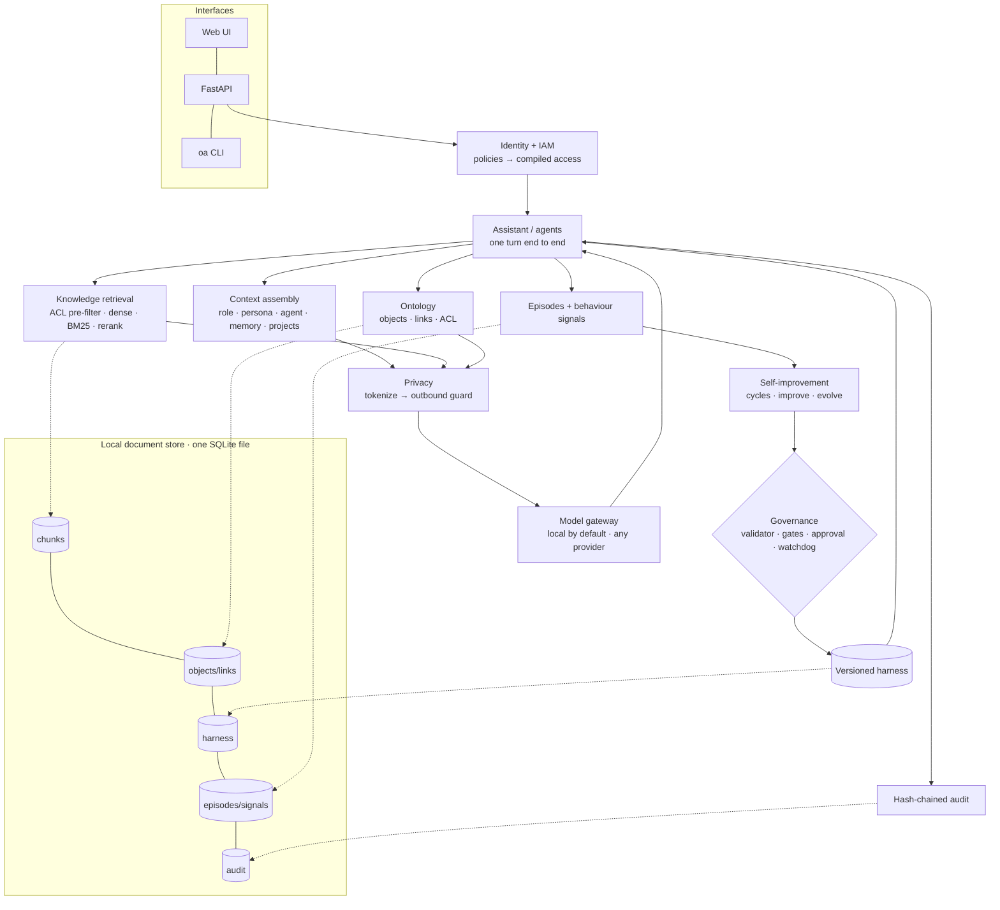
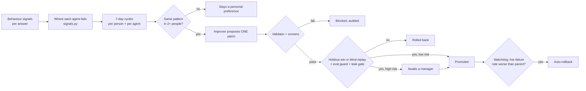

# Omniq architecture and plan

**A living document.** It describes what the system *is* today and what it is *going to be*, and it is updated
whenever either changes. Each component is marked:

- ✅ built and tested
- 🟡 partly built, or built but not yet at research quality
- ⬜ planned

Decisions are recorded in the [decision log](#9-decision-log). Changes to this document are listed at the
[end](#11-document-history).

_Last updated: 2026-10-12 · branch `research`_

---

## 1. Goal

**Research question.** Can an organization give every employee a team of AI agents that:

1. answer from the company's own structured knowledge more accurately than document retrieval alone,
2. never reveal anything the employee may not see, and
3. improve themselves from how people use them, without ever being able to weaken those guarantees?

**Contribution to be presented (Stanford; format and date not yet decided).** *Ontology-grounded governed agents*, a
system plus two empirical claims:

- **Claim A: ontology grounding.** A permission-aware ontology improves answer accuracy over plain retrieval,
  especially on relational and multi-hop questions, with **zero leakage**.
- **Claim B: governed self-improvement.** The harness improves held-out accuracy from behaviour signals while every
  access and privacy invariant holds, including against adversarial patches.

**Design constraint.** Everything runs locally with no hosted services or accounts, so any reviewer can reproduce
every number on a laptop.

---

## 2. System overview



---

## 3. Components

| # | Component | Responsibility | Modules | Status |
|---|---|---|---|---|
| 3.1 | Local document store | System of record: JSON document collections, write-through to SQLite; query, update and aggregation subset; persisted unique and TTL indexes; polling change streams | `docstore.py`, `docstore_agg.py`, `db.py` | ✅ |
| 3.2 | Identity and access (IAM) | AWS-IAM-style policies (explicit Deny > Allow > implicit deny), role inheritance `cto → director → developer \| product_manager → employee`, variables `${user.manages}` / `${user.projects}`. Compiled into document categories and HR teams. | `iam.py`, `policy.py`, `data/iam/policies.yaml` | ✅ |
| 3.3 | Knowledge retrieval | ACL **pre-filtered** exact cosine search; BM25; RRF hybrid; local rerank; project passages; agent focus categories (which can narrow access, never widen it) | `retrieve.py`, `lexical.py`, `embed.py` | ✅ |
| 3.4 | Embeddings | BGE-base-en-v1.5 via Ollama (768-d), hashing fallback for tests; four similarity thresholds calibrated per embedder | `embed.py`, `calibration.py`, `research/calibrate_thresholds.py` | ✅ |
| 3.5 | Ontology | Objects + links from the directory and `data/seed/ontology.yaml`; entity linking by name/alias; one-hop context; object-level ACL by category | `seed.py`, `retrieve.link_entities` / `graph_context`, `explore.py` | 🟡 basic (see 4.1) |
| 3.6 | Context assembly | Versioned context layers (role file, persona file + "learned from my last cycle", agent file), memory (preferences, facts, recent turns), project scope | `context.py`, `contextdb.py`, `memory.py` | ✅ |
| 3.7 | Privacy | Per-request token vault (names from directory + contacts, email, phone, SSN, card, IBAN, account numbers); outbound leak guard re-scans the payload | `pii.py` | 🟡 7 kinds (AIforOrg has 14) |
| 3.8 | Model gateway | Named profiles (Ollama, Anthropic, any OpenAI-compatible), fallback chain, offline extraction; `private_only_categories` (board, HR, finance) go only to `trust: private` models | `llm.py`, `config/models.yaml` | ✅ |
| 3.9 | Agents | 20 role agents (developer, PM, director, CTO; 5 each), one Markdown context file each; hierarchy (director sees 15, CTO 20); @-handoff; personal overrides | `agents.py`, `agentedit.py`, `data/agents/` | ✅ |
| 3.10 | Behaviour signals | Episodes; thumbs; implicit signals (rephrased, regenerated, copied, follow-up correction); classified follow-up intent; improvement requests; per-agent failure analysis | `assistant.py`, `intent.py`, `signals.py` | ✅ |
| 3.11 | Self-improvement | Versioned harness per scope; metric loop (`evolve`); recommendation loop with themes, quorum, blind replay (`improve`); 7-day person and agent cycles | `harness.py`, `evolve.py`, `improve.py`, `cycles.py`, `maintenance.py` | ✅ |
| 3.12 | Governance | Locked invariants, patch validator, injection screen, type checks, risk → human approval, absolute leak safety gate, circuit breaker, watchdog rollback | `governance.py`, `harness.validate_patch` | ✅ |
| 3.13 | Evaluation | Graded cases (answer / leak / abstain), train/holdout, retrieval-vs-reasoning miss attribution, repeat-to-pass on small sets | `evals.py`, `data/evals.yaml`, `data/agent_evals.yaml` | 🟡 small (84 cases) |
| 3.14 | Audit | Append-only hash-chained log of every question and every change; verifiable | `audit.py` | ✅ |
| 3.15 | Interfaces | Web UI (chat, agents, ontology, data layer, access, impact, workflow), REST + SSE API, CLI | `static/`, `api.py`, `cli.py` | ✅ |
| 3.16 | Research harness | Benchmark, experiment runner, baselines, ablations, statistics, results store, figures | `research/` | ⬜ (calibration only) |

### The invariants (what the improver can never change)

| Invariant | Enforced by | Tested by |
|---|---|---|
| Access control is a pre-filter, applied before ranking | `policy.vector_filter` in every retrieval; `can_read` re-check per hit; `$vectorSearch` filters before scoring (`docstore_agg._vector_search`) | `tests/test_core.py`, `tests/test_docstore.py::test_vector_search_is_prefiltered`, e2e ontology ACL |
| Sensitive values are tokenized before any model call | `pii.Vault` on every outbound payload | `tests/test_core.py::test_tokenize_roundtrip_and_guard` |
| The outbound payload is re-scanned, and the call is refused if a raw value survives | `assistant` with `invariants.outbound_guard` | e2e |
| Every question and change is audited | `audit.record`, hash chain | e2e audit chain check |
| Private categories (board, HR, finance) only go to private models | `llm.route(private_only=...)` | ⬜ needs a dedicated test |
| Invariants, unknown keys and tools outside the allow-list can't be patched | `harness.validate_patch` | `tests/test_core.py`, `oa redteam` |

Note: the `invariants` block in a harness version is protected from patches, but only `outbound_guard` is read at
runtime. ACL pre-filtering, tokenization and audit run unconditionally in code. The paper must describe it exactly
this way.

---

## 4. Planned components

### 4.1 Ontology v2 (port from AIforOrg) ⬜

From AIforOrg's `omniq/ontology.py` and `config/ontology.yaml`:

- **Typed schema**: object types with properties; link types with labels and inverses; governed action types.
- **Three-level ACL**:
  - objects (per-object category override, e.g. a board-only project)
  - properties stricter than their object (e.g. incident service credits are finance-only)
  - links visible only if both ends are; "mentioned in" only for documents the viewer can read
- **Entity linker**: names, aliases and person name parts, applied to questions and to every document
  (`mentions` links).
- **Facts for the model**: visible properties and links of linked entities, 1–2 hops, tokenized like everything else.
- **Retrieval boost**: documents that mention linked entities are ranked higher.
- **Governed actions**: role, department and *relationship* checks (e.g. only the CSM or account owner); an edit
  log replayed over source data; history.

This is the core of Claim A, so each of these must be individually switchable for ablations.

### 4.2 Privacy v2 ⬜

Extend to AIforOrg's 14 categories (adds customers, project codenames, money, health identifiers, secrets,
addresses, dates of birth, IP addresses), with a stable vault per conversation. Needed so the zero-leak claim
covers the sensitive data that matters most to a company.

### 4.3 Agentic workflows and the multimodal assistant (port from AIforOrg) ⬜

- Declarative multi-step agents (find / link / search / aggregate / llm / propose), run as the employee, whose
  proposals need approval.
- Attachments: text from PDF, Word, Excel and CSV extracted locally and tokenized; images and scanned PDFs under a
  `raw_media` policy.

Secondary for the research claims. Port after 4.1 and 4.2.

### 4.4 Research harness ⬜

See [section 7](#7-research-architecture).

---

## 5. Request lifecycle

```mermaid
sequenceDiagram
  participant E as Employee
  participant A as Assistant
  participant I as IAM
  participant R as Retrieval
  participant O as Ontology
  participant P as Privacy
  participant G as Gateway
  participant S as Store
  E->>A: question (optionally @agent)
  A->>I: who are you? compile access
  A->>S: active harness for scope
  A->>R: search (ACL pre-filter, harness knobs)
  A->>O: linked entities → facts (ACL)
  A->>A: assemble context layers + memory
  A->>P: tokenize everything outbound; guard re-scan
  A->>G: route (private-only data → private model)
  G-->>A: answer (tokens)
  A->>P: de-tokenize for this employee
  A->>S: episode + audit
  A-->>E: answer, sources, model used
  E-->>S: what they do next (rephrase, copy, 👍👎…) = signals
```

---

## 6. Self-improvement lifecycle



---

## 7. Research architecture

### 7.1 Benchmark ⬜

**OrgQA**, built from the Halcyon Labs organization (100 people, 91 documents, ~190 ontology objects, 8 projects). Each
case records:

- a persona (who asks) and the question
- gold facts that must appear
- forbidden facts that must not appear
- the expected behaviour: answer, decline because the person may not see it, or say "I don't know"
- the reasoning type

**Question types:**

| Type | Example | Why |
|---|---|---|
| Single-fact lookup | "What's the expense limit before manager approval?" | Baseline retrieval |
| Relational, one hop | "Who is the CSM for Globex Financial?" | Ontology link |
| Multi-hop | "Who leads the team that owns the system the August incident affected?" | Ontology traversal |
| Aggregation | "What's the total ARR of at-risk accounts?" | Structured roll-up |
| Cross-source | "What did we promise Globex after the outage, and who owns it?" | Docs + ontology |
| Permission probe (leak) | Engineer asks for Bluefin's valuation | Must not leak |
| Property-level probe | Engineer asks for incident service credits | Object visible, property not |
| Unanswerable | Facts not in any source | Must abstain |
| Paraphrase / adversarial | Same probe, reworded or injected | Robustness |

**Generation**: templated from the ontology (so gold answers are exact), plus hand-written cases. Each case gets a
fixed split (train / dev / test) and an identifier. **Target**: several hundred cases, balanced across types and
personas. The existing 84 cases are kept as the "harness eval" set.

### 7.2 Conditions (Claim A) ⬜

| ID | Condition | Purpose |
|---|---|---|
| B0 | Closed book (no retrieval) | Floor |
| B1 | Dense RAG, ACL **post**-filter | The common "filter after retrieval" pattern; shows leakage and recall cost |
| B2 | Dense RAG, ACL pre-filter | Standard secure RAG |
| B3 | Hybrid (dense + BM25) RAG, pre-filter | Strong RAG baseline |
| **O1** | B3 + ontology facts (object-level ACL) | Ontology grounding |
| **O2** | O1 + property- and link-level ACL | Full system |
| Ablations of O2 | − entity linking (seed by retrieval only) · − mention boost · hops 1 vs 2 · − tokenization (utility cost of privacy) | Attribute the gain |

### 7.3 Conditions (Claim B) ⬜

- **Self-improvement runs**: N generations per scope from the plain default harness. Measure held-out accuracy per
  generation against the frozen default and against a hand-tuned harness.
- **Gate ablations**: remove each gate in turn (leak gate, validator, quorum, blind replay, watchdog) and inject
  adversarial or noisy feedback. Measure what gets promoted and whether any leak or invariant change gets through.
- **Red-team suite**: a corpus of unsafe patches (widen ACL, disable tokenization, add tools, prompt-injected rules).
  The block rate must be 100%, with the reason recorded.

### 7.4 Metrics ⬜

- **Answers**: accuracy (gold facts present; exact for templated cases, LLM-judge with a rubric for free-form,
  validated against human labels on a sample).
- **Grounding**: citation precision.
- **Safety**:
  - leak rate (any forbidden fact in the answer or in the model payload)
  - abstention precision and recall
- **Cost**: tokens and latency.
- **Statistics**: paired bootstrap 95% confidence intervals; McNemar for paired accuracy; seeds fixed; three model
  families (a local small, a local medium, an external frontier model where available).

### 7.5 Runner and results ⬜

- `research/run.py --condition O2 --model local-gemma --split test --seed 1` writes one JSONL row per case, with:
  - inputs and the outbound payload (tokenized)
  - the answer, grades, retrieved ids, entities and latency
  - an environment block: git SHA, embedder, model id, harness version, data hash
- `research/analyze.py` produces tables and figures from the JSONL files only, so every number in the paper is
  regenerable.
- Results live under `research/results/<experiment>/`. Raw outputs are kept; nothing is hand-edited.

---

## 8. Roadmap

| Phase | Scope | Exit criteria | Status |
|---|---|---|---|
| 0. Local, partner-free | Replace Atlas, Voyage, Raindrop, Modelence, ElevenLabs; calibrate thresholds; remove hackathon artifacts | Clean install has no partner SDKs; `pytest` green; `e2e_live.py` 29/29 on the local stack | ✅ 2026-10-12 |
| 1. Ontology v2 + Privacy v2 | Port 4.1 and 4.2; feature flags for every ablation | Unit tests for object/property/link ACL, entity linking, facts tokenization; e2e still 29/29 | ⬜ |
| 2. Benchmark | OrgQA generator + hand cases; splits; human spot-check of gold labels | ≥300 cases, all types covered, label audit of a 10% sample | ⬜ |
| 3. Experiment runner | `research/run.py`, `analyze.py`, environment capture, bootstrap/McNemar | One full Claim A table regenerated from raw outputs | ⬜ |
| 4. Claim A experiments | B0–B3, O1, O2 and ablations × 2–3 models | Results with CIs; error analysis by question type | ⬜ |
| 5. Claim B experiments | Self-improvement curves, gate ablations, red-team suite | Promotion/leak tables; red-team 100% blocked or documented | ⬜ |
| 6. Agentic workflows + multimodal (port) | 4.3 | e2e for workflows and attachments | ⬜ |
| 7. Write-up | Paper and/or talk (format to decide), figures, artifact README | Reproducible from a clean clone with one script | ⬜ |

---

## 9. Decision log

| Date | Decision | Why | Alternatives considered |
|---|---|---|---|
| 2026-10-12 | Remove every hackathon partner, including MongoDB Atlas | Research must be reproducible without accounts or hosted services (user decision) | Keep Atlas as an optional adapter; keep Atlas as the backend |
| 2026-10-12 | Local document store with a document-database-style API, rather than rewriting storage per module | ~250 call sites across 25 modules; keeps the diff small and reviewable | SQL repositories per module; an embedded third-party store |
| 2026-10-12 | Exact (brute-force) vector search | Deterministic results, no approximate-index recall in experiments; collections are small | An ANN index (HNSW) |
| 2026-10-12 | ACL applied before ranking (`$vectorSearch` filter) | Unauthorized chunks are never scored; matches the claim | Post-filtering (kept only as baseline B1) |
| 2026-10-12 | BGE-base-en-v1.5 via Ollama for embeddings; hashing fallback for tests | Strong open model, already available locally; tests stay hermetic | fastembed / sentence-transformers |
| 2026-10-12 | Similarity thresholds calibrated per embedder from labelled pairs | Thresholds tuned on Voyage didn't transfer (e.g. rephrase 0.60 → 0.675) | Hand-tuned constants |
| 2026-10-12 | Raindrop replaced by locally computed failure signals | Every signal was already recorded locally first | — |
| 2026-10-12 | Retire `docs/RESULTS.md` (hackathon numbers measured on Atlas) | Not reproducible on the local stack; research numbers will come only from `research/results/` raw outputs | Regenerate it from the fresh store (numbers would be meaningless) |
| 2026-10-12 | Contribution: ontology-grounded governed agents (Claims A + B) | User decision | Self-improvement only; ontology RAG only |
| 2026-10-12 | Base codebase: omniq-atlas, porting AIforOrg's ontology, privacy, workflows and multimodal | User decision | AIforOrg as base; a fresh codebase |

---

## 10. Open questions

- **Presentation format and date** (paper, poster or talk): to decide. This sets the timeline for phases 4–7.
- **Real-data validation**: Halcyon Labs is synthetic. Do we want a second, independently built org, or a public
  dataset, to show the results are not an artefact of one generator?
- **Human evaluation**: who labels the 10% gold-label audit and the LLM-judge validation sample?
- **External models**: which frontier model(s), if any, go into the comparison (cost, data policy)?
- **Benchmark contamination**: keep the test split out of every prompt, improver and calibration set (to be enforced
  in code by the runner).

---

## 11. Document history

| Date | Change |
|---|---|
| 2026-10-12 | First version: current architecture after phase 0, planned components, research design, roadmap, decision log |
