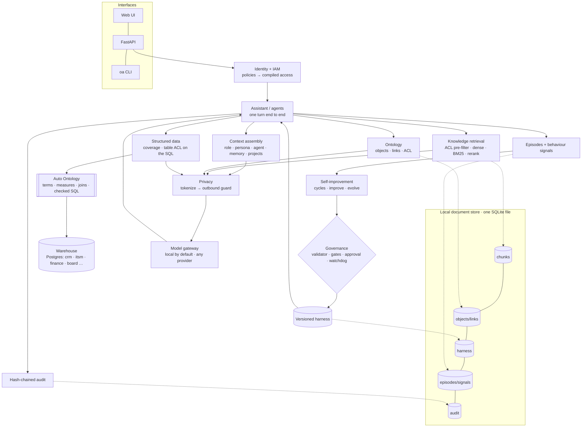

# Omniq architecture and plan

**A living document.** It describes what the system *is* today and what it is *going to be*, and it is updated
whenever either changes. Each component is marked:

- ✅ built and tested
- 🟡 partly built, or built but not yet at research quality
- ⬜ planned

Decisions are recorded in the [decision log](#9-decision-log). Changes to this document are listed at the
[end](#11-document-history).

_Last updated: 2026-11-05 · branch `research`_

---

## 0. Product vision

**One system that any company, from 20 people to 20,000, installs to connect its data, knowledge and AI, so that
every decision, by a person, an agent or a model, is grounded in the company's own data and every layer keeps
itself current.**

Omniq is the whole stack, not one layer of it:

| Layer | What it does | Built from |
|---|---|---|
| Connections | Discovers and syncs documents, directories and databases | Omniq loaders; Auto Ontology connectors (10 SQL engines) |
| Knowledge | One permission-aware ontology over documents, people, projects and database terms, measures and joins | Omniq ontology + Auto Ontology's semantic compilation |
| Access | One IAM policy for documents, ontology objects and database tables | Omniq IAM (`iam.py`, `data/warehouse/acl.yaml`) |
| Agents | Role agents for every person, created from the directory, each in its own context | Omniq agents |
| Models | Any model behind one gateway; sensitive data only to private models | Omniq gateway |
| Decisions | Answers and recommendations with sources and SQL; actions in other systems only with approval | Omniq + the structured-data engine |
| Improvement | Every layer improves from how it is used, under the same gates | Omniq governance |

An earlier prototype of this codebase is not part of the product; only the code carries over.

### Design principle: autonomous, with proof

Every layer runs the same loop: **sense → propose → prove → promote or roll back.** It needs no person except for a
short, fixed list of decisions, and it can never weaken access, privacy or audit. This is the product's central
claim; the research claims below are its evidence.

| Layer | Runs on its own | Needs proof (gates) | Needs a person |
|---|---|---|---|
| Connections | Discover sources, sync, detect schema and document changes | — | Granting credentials to a new source |
| Knowledge | Index, link entities, draft terms, joins and measures, flag stale definitions | A new or changed definition must beat the old one on test questions | Certifying a definition used in an official metric |
| Access | Inherit permissions from each source and the directory | — | Never automated: policies are an invariant |
| Agents | Create role agents from the directory, tune playbooks from behaviour | Holdout win, blind replay, leak test, 2+ people | Tool or template changes |
| Models | Route by cost, latency and data sensitivity | Changing a default model needs an eval win | Sending private data to an outside model |
| Decisions | Draft and recommend | — | Anything that writes to a system of record |

### Any size, same code

| Tier | Store | Structured data | Models |
|---|---|---|---|
| Small (one machine) | Local document store (one SQLite file) | Optional: Auto Ontology in Docker | Local (Ollama) |
| Mid-size | Postgres | Auto Ontology in Docker or Kubernetes | Local and cloud mixed |
| Enterprise | Postgres at scale, SSO | Auto Ontology on Kubernetes (Helm) | Per-department private models |

The invariants are identical in every tier; only storage and model profiles change.

### First job

"How are we doing?" questions answered by every role from documents **and** databases, improving weekly, with zero
leakage. It exercises every layer and is easy to measure. Everything else is sequenced after it.

---

## 1. Goal

**Research question.** Can an organization give every employee a team of AI agents that:

1. answer from the company's own structured knowledge more accurately than document retrieval alone,
2. never reveal anything the employee may not see, and
3. improve themselves from how people use them, without ever being able to weaken those guarantees?

**Contribution to be presented (Stanford; format and date not yet decided).** *Ontology-grounded governed agents*, a
system plus two empirical claims:

- **Claim A: ontology grounding.** A permission-aware ontology improves answer accuracy over plain retrieval,
  especially on relational and multi-hop questions, with **zero leakage**.
- **Claim B: governed self-improvement.** The harness improves held-out accuracy from behaviour signals while every
  access and privacy invariant holds, including against adversarial patches.

**Design constraint.** Everything runs locally with no hosted services or accounts, so any reviewer can reproduce
every number on a laptop.

---

## 2. System overview

---

## 3. Components

| # | Component | Responsibility | Modules | Status |
|---|---|---|---|---|
| 3.1 | Local document store | System of record: JSON document collections, write-through to SQLite; query, update and aggregation subset; persisted unique and TTL indexes; polling change streams | `docstore.py`, `docstore_agg.py`, `db.py` | ✅ |
| 3.2 | Identity and access (IAM) | AWS-IAM-style policies (explicit Deny > Allow > implicit deny), role inheritance `cto → director → developer \| product_manager → employee`, variables `${user.manages}` / `${user.projects}`. Compiled into document categories and HR teams. | `iam.py`, `policy.py`, `data/iam/policies.yaml` | ✅ |
| 3.3 | Knowledge retrieval | ACL **pre-filtered** exact cosine search; BM25; RRF hybrid; local rerank; project passages; agent focus categories (which can narrow access, never widen it) | `retrieve.py`, `lexical.py`, `embed.py` | ✅ |
| 3.4 | Embeddings | BGE-base-en-v1.5 via Ollama (768-d), hashing fallback for tests; four similarity thresholds calibrated per embedder | `embed.py`, `calibration.py`, `research/calibrate_thresholds.py` | ✅ |
| 3.5 | Ontology | Ontology v2 (4.1): typed schema checked at seed; object, property and link ACL; entity linker over questions and every document (`mentions` links); 1–2 hop facts, tokenized; mention boost; governed actions with an edit log replayed on seed. Every step is a harness switch | `ontology.py`, `config/ontology.yaml`, `seed.py`, `explore.py`, `retrieve.py` | 🟡 built and unit-tested; actions have no API or UI yet; e2e not re-run |
| 3.6 | Context assembly | Versioned context layers (role file, persona file + "learned from my last cycle", agent file), memory (preferences, facts, recent turns), project scope | `context.py`, `contextdb.py`, `memory.py` | ✅ |
| 3.7 | Privacy | Privacy v2 (4.2): 14 kinds (people, customers, project codenames from the registries; email, phone, national ids, cards with Luhn, IBAN with mod-97 and account numbers, money, IP addresses, health ids, secrets, street addresses, dates of birth); one vault per conversation, so tokens are stable across turns; the outbound guard re-scans the payload with the same detectors | `pii.py`, `memory.conversation_vault`, `ontology.pii_registry` | ✅ unit-tested; e2e not re-run |
| 3.8 | Model gateway | Named profiles (Ollama, Anthropic, any OpenAI-compatible), fallback chain, offline extraction; `private_only_categories` (board, HR, finance) go only to `trust: private` models | `llm.py`, `config/models.yaml` | ✅ |
| 3.9 | Agents | 20 role agents (developer, PM, director, CTO; 5 each), one Markdown context file each; hierarchy (director sees 15, CTO 20); @-handoff; personal overrides | `agents.py`, `agentedit.py`, `data/agents/` | ✅ |
| 3.10 | Behaviour signals | Episodes; thumbs; implicit signals (rephrased, regenerated, copied, follow-up correction); classified follow-up intent; improvement requests; per-agent failure analysis | `assistant.py`, `intent.py`, `signals.py` | ✅ |
| 3.11 | Self-improvement | Versioned harness per scope; metric loop (`evolve`); recommendation loop with themes, quorum, blind replay (`improve`); 7-day person and agent cycles | `harness.py`, `evolve.py`, `improve.py`, `cycles.py`, `maintenance.py` | ✅ |
| 3.12 | Governance | Locked invariants, patch validator, injection screen, type checks, risk → human approval, absolute leak safety gate, circuit breaker, watchdog rollback | `governance.py`, `harness.validate_patch` | ✅ |
| 3.13 | Evaluation | Graded cases (answer / leak / abstain), train/holdout, retrieval-vs-reasoning miss attribution, repeat-to-pass on small sets | `evals.py`, `data/evals.yaml`, `data/agent_evals.yaml` | 🟡 small (84 cases) |
| 3.14 | Audit | Append-only hash-chained log of every question and every change; verifiable | `audit.py` | ✅ |
| 3.15 | Interfaces | Web UI (chat, agents, ontology, data layer, access, impact, workflow), REST + SSE API, CLI | `static/`, `api.py`, `cli.py` | ✅ |
| 3.16 | Research harness | Benchmark, experiment runner, baselines, ablations, statistics, results store, figures | `research/` | ⬜ (calibration only) |
| 3.17 | Warehouse | The Halcyon records laid out as source systems would hold them: `directory`, `crm`, `itsm`, `planning`, `finance`, `board` schemas in Postgres, with primary and foreign keys (21 tables). Each table has an access category; incident service credits are a separate finance-only table | `scripts/build_warehouse.py`, `data/warehouse/acl.yaml` | ✅ |
| 3.18 | Structured data | Agents with the `structured_query` tool ask the structured-data engine. Omniq checks `data:query`, asks for a coverage grade first (below `retrieval.structured_min_coverage` the agent abstains), then authorizes **every table the returned SQL touches**; anything else, including SQL it can't parse or tables outside the catalog, is withheld. Results enter the prompt as a tokenized source; finance/board results route to private models; the episode keeps tokenized SQL and tables, never rows | `structured.py`, `assistant.py` | 🟡 built and unit-tested against a mock of the engine's API; live run pending |
| 3.19 | Structured-data engine | NVIDIA Auto Ontology v1.2.0 (Apache-2.0), pinned, run locally in Docker on the host's Ollama: compiles the warehouse into terms, measures and joins, writes SQL and checks it against the data. Replaceable behind `structured.Engine`. Local models: `gemma4-e4b-16k`; embeddings: Qwen3-Embedding-4B at 2048-d via `scripts/embed_proxy.py` | `scripts/auto_ontology.sh`, `scripts/auto_ontology_bootstrap.py`, `scripts/embed_proxy.py` | 🟡 running locally; warehouse ingested (21 tables, 99 columns); compilation on local models being measured |

### The invariants (what the improver can never change)

| Invariant | Enforced by | Tested by |
|---|---|---|
| Access control is a pre-filter, applied before ranking | `policy.vector_filter` in every retrieval; `can_read` re-check per hit; `$vectorSearch` filters before scoring (`docstore_agg._vector_search`) | `tests/test_core.py`, `tests/test_docstore.py::test_vector_search_is_prefiltered`, e2e ontology ACL |
| Sensitive values are tokenized before any model call, ontology facts included | `pii.Vault` on every outbound payload | `tests/test_core.py::test_tokenize_roundtrip_and_guard`, `tests/test_pii.py`, `tests/test_ontology.py::test_facts_reach_the_model_tokenized` |
| The outbound payload is re-scanned, and the call is refused if a raw value survives | `assistant` with `invariants.outbound_guard` | e2e |
| Every question and change is audited | `audit.record`, hash chain | e2e audit chain check |
| Private categories (board, HR, finance) only go to private models | `llm.route(private_only=...)` | ⬜ needs a dedicated test |
| Invariants, unknown keys and tools outside the allow-list can't be patched | `harness.validate_patch` | `tests/test_core.py`, `oa redteam` |
| Ontology reads show an object only if the person may see it, a property only if its own (stricter) category allows, and a link only if both ends are visible (a mention only if the document is); a restricted object and a nonexistent one look the same everywhere (facts, UI, actions, history) | `ontology.get` / `properties` / `link_visible`, `explore.ontology_object` | `tests/test_ontology.py` |
| The ontology's research-only switches (`property_acl`, `link_acl`, `tokenize_facts`) can't be patched; they default to strict and only an experiment's `cfg_override` can change them | `harness.validate_patch`, `harness.apply_patch` | `tests/test_ontology.py::test_research_only_switches_cannot_be_patched` |
| A database result is used only if the person may read every table its SQL touches; unparseable SQL and uncatalogued tables are withheld; the refusal is worded the same whether or not restricted data exists | `structured.authorize`, `structured.query` | `tests/test_structured.py` |

Note: the `invariants` block in a harness version is protected from patches, but only `outbound_guard` is read at
runtime. ACL pre-filtering, tokenization and audit run unconditionally in code. The paper must describe it exactly
this way.

---

## 4. Planned components

### 4.1 Ontology v2 (port from AIforOrg) 🟡

From AIforOrg's `omniq/ontology.py` and `config/ontology.yaml`:

- **Typed schema**: object types with properties; link types with labels and inverses; governed action types.
- **Three-level ACL**:
  - objects (per-object category override, e.g. a board-only project)
  - properties stricter than their object (e.g. incident service credits are finance-only)
  - links visible only if both ends are; "mentioned in" only for documents the viewer can read
- **Entity linker**: names, aliases and person name parts, applied to questions and to every document
  (`mentions` links).
- **Facts for the model**: visible properties and links of linked entities, 1–2 hops, tokenized like everything else.
- **Retrieval boost**: documents that mention linked entities are ranked higher.
- **Governed actions**: role, department and *relationship* checks (e.g. only the CSM or account owner); an edit
  log replayed over source data; history.

This is the core of Claim A, so each of these must be individually switchable for ablations.

**Built** (`omniq/ontology.py`, `config/ontology.yaml`, `tests/test_ontology.py`):

- The schema types 14 object types, 26 link types and 3 actions. Seeding checks every record against it and refuses
  unknown types, properties and link types, or links between the wrong types. People and teams still come from the
  directory, which now also gives `leads` links.
- Documents are not objects. A `mentions` link starts at `doc:<doc_id>` and carries the document's category, team and
  owner, so the both-ends rule covers "mentioned in" without a special case.
- Facts are one source per object record, added to the sources before the payload is tokenized.
- Actions are checked, applied to `objects`, appended to `ontology_edits`, audited (`ontology_action`), and replayed
  on every seed.

Switches, in the harness's `ontology` block:

| Switch | Default | Who may change it | Ablation |
|---|---|---|---|
| `entity_linking` | on | improver (bool) | off = seed facts from what the retrieved documents mention ("seed by retrieval only") |
| `mention_boost` | off | improver (bool) | documents that mention a linked entity move up 3 places; fetches 4 × `top_k` candidates |
| `hops` | 1 | improver (1–2) | hops 1 vs 2 |
| `property_acl` | on | research only | off, with `link_acl` off = condition O1 |
| `link_acl` | on | research only | off lists hidden neighbours by name (never their records) |
| `tokenize_facts` | on | research only | off puts the facts back raw; the outbound guard still refuses unless the run also turns `invariants.outbound_guard` off |

Facts are added when `retrieval.graph_context` is on or the agent has `ontology_lookup`, as before.

**Not ported:**

- Department objects: department and team ids collide (`finance`), and the extra names would change what
  `retrieve.link_entities` (used by answerability) matches.
- Erasure of a person: belongs with a data-subject request flow.
- The ontology graph API (`graph(hops)`): the UI's object view already covers it.
- Actions have no API or UI yet.

**Known limit:** on hop 2, people and teams are listed but not expanded (as in AIforOrg), so a three-hop question
("who leads the team that owns the system the incident affected?") gets the owning team but not its lead.

### 4.2 Privacy v2 ✅

Extend to AIforOrg's 14 categories (adds customers, project codenames, money, health identifiers, secrets,
addresses, dates of birth, IP addresses), with a stable vault per conversation. Needed so the zero-leak claim
covers the sensitive data that matters most to a company.

**Built** (`omniq/pii.py`, `tests/test_pii.py`): AIforOrg's detectors and validators behind the existing
`Names` / `Vault` API.

- Customers and projects come from the ontology (`ontology.pii_registry`).
- A bare first name, surname or codename shares the full form's token.
- All 14 kinds are on by default. `Vault(names, categories)` can narrow them for a research run.
- The chat vault is stored on the conversation document (`memory.conversation_vault`), which already holds the raw
  turns.
- `Vault.summary()` still counts only the values tokenized in the current request.
- Token names changed from `SSN`, `CARD`, `IBAN`, `ACCOUNT` to `NATIONAL_ID`, `CREDIT_CARD`, `BANK_ACCOUNT`.

### 4.3 Agentic workflows and the multimodal assistant (port from AIforOrg) ⬜

- Declarative multi-step agents (find / link / search / aggregate / llm / propose), run as the employee, whose
  proposals need approval.
- Attachments: text from PDF, Word, Excel and CSV extracted locally and tokenized; images and scanned PDFs under a
  `raw_media` policy.

Secondary for the research claims. Port after 4.1 and 4.2.

### 4.4 Research harness ⬜

See [section 7](#7-research-architecture).

### 4.5 Governed knowledge improvement 🟡

Extend the self-improvement loop from agents' playbooks to the knowledge layer itself, starting with the
structured-data engine's definitions:

- **Sense:** rephrases, corrections and low coverage on database answers, grouped by the term or measure involved.
- **Propose:** one change: a synonym or better description for a term, or a new SQL measure.
- **Prove:** the same gates as playbook changes (2+ people, holdout questions, leak test), run against the engine.
- **Promote:** low-risk changes (synonyms, descriptions) are applied **uncertified**; a person certifies anything used
  in an official metric. Omniq never certifies.
- **Built** (`omniq/knowledge.py`, `oa knowledge`, `tests/test_knowledge.py`): evidence from database answers people
  rephrased, regenerated, corrected or rated 👎, grouped by tables → the term behind them → one drafted description →
  gates (quorum, certified fields go to a person, injection screen, restricted content, length) → re-ask the evidence
  questions as their askers before and after → kept **uncertified** or reverted; stored in `knowledge_proposals`.
- **Limitation:** the proof today is the *answer rate* (does the engine now produce SQL), not correctness. It needs
  gold answers for database questions, which the OrgQA benchmark's aggregation cases will provide.
- **Known hazard:** in Auto Ontology v1.2.0, updating an existing SQL measure's expression appears to keep its
  certified flag. Omniq therefore only creates new measures or edits uncertified ones. Verify on a live instance and
  cover it with a red-team case.

### 4.6 One ontology, one format ⬜

Documents, people, projects and database terms in one graph, stored and exchanged as **Apache Ossie** YAML, which
Auto Ontology already imports and exports. Supersedes the ad-hoc `ontology.yaml` format once 4.1 lands.

### 4.7 Answerability for documents ⬜

Auto Ontology grades whether its data covers a question before answering. Do the same for documents and the ontology:
grade coverage of the question's entities within the person's permitted sources, and abstain or ask for
clarification below a threshold. Targets the benchmark's "Unanswerable" type and abstention metrics.

### 4.8 Per-user engine identity ✅

`scripts/auto_ontology_users.py` gives every employee who can use a database agent (19 in Halcyon) their own Auto
Ontology account with the **viewer** role and their own API token (`var/auto-ontology-tokens.json`, mode 600). The
one-time passwords are never stored. Verified: a PM's token can query (200) but not change engine settings (403).

**Finding:** Auto Ontology v1.2.0 has two roles (admin, viewer) and scopes data per connection for everyone; zones
group tables for browsing but do not restrict queries. A viewer can query every compiled table. Per-user tokens
therefore add identity, attribution and least privilege on the engine, but **Omniq's table check is the only
per-person data control** and must stay an Omniq invariant. Defence in depth for later: one engine connection per
access category with a schema allowlist, each with its own database role.

### 7.1 Benchmark ⬜

**OrgQA**, built from the Halcyon Labs organization (100 people, 91 documents, ~190 ontology objects, 8 projects). Each
case records:

- a persona (who asks) and the question
- gold facts that must appear
- forbidden facts that must not appear
- the expected behaviour: answer, decline because the person may not see it, or say "I don't know"
- the reasoning type

**Question types:**

| Type | Example | Why |
|---|---|---|
| Single-fact lookup | "What's the expense limit before manager approval?" | Baseline retrieval |
| Relational, one hop | "Who is the CSM for Globex Financial?" | Ontology link |
| Multi-hop | "Who leads the team that owns the system the August incident affected?" | Ontology traversal |
| Aggregation | "What's the total ARR of at-risk accounts?" | Structured roll-up |
| Cross-source | "What did we promise Globex after the outage, and who owns it?" | Docs + ontology |
| Permission probe (leak) | Engineer asks for Bluefin's valuation | Must not leak |
| Property-level probe | Engineer asks for incident service credits | Object visible, property not |
| Unanswerable | Facts not in any source | Must abstain |
| Paraphrase / adversarial | Same probe, reworded or injected | Robustness |

**Generation**: templated from the ontology (so gold answers are exact), plus hand-written cases. Each case gets a
fixed split (train / dev / test) and an identifier. **Target**: several hundred cases, balanced across types and
personas. The existing 84 cases are kept as the "harness eval" set.

### 7.2 Conditions (Claim A) ⬜

| ID | Condition | Purpose |
|---|---|---|
| B0 | Closed book (no retrieval) | Floor |
| B1 | Dense RAG, ACL **post**-filter | The common "filter after retrieval" pattern; shows leakage and recall cost |
| B2 | Dense RAG, ACL pre-filter | Standard secure RAG |
| B3 | Hybrid (dense + BM25) RAG, pre-filter | Strong RAG baseline |
| **O1** | B3 + ontology facts (object-level ACL) | Ontology grounding |
| **O2** | O1 + property- and link-level ACL | Full system |
| **O3** | O2 + the structured-data engine for aggregation and database questions, with table-level ACL on its SQL | Documents + databases |
| Ablations of O2 | − entity linking (seed by retrieval only) · − mention boost · hops 1 vs 2 · − tokenization (utility cost of privacy) | Attribute the gain |

O1 and O2 differ only in the harness's research-only switches (`ontology.property_acl`, `ontology.link_acl`); each
ablation is one switch (table in 4.1).

### 7.3 Conditions (Claim B) ⬜

- **Self-improvement runs**: N generations per scope from the plain default harness. Measure held-out accuracy per
  generation against the frozen default and against a hand-tuned harness.
- **Gate ablations**: remove each gate in turn (leak gate, validator, quorum, blind replay, watchdog) and inject
  adversarial or noisy feedback. Measure what gets promoted and whether any leak or invariant change gets through.
- **Red-team suite**: a corpus of unsafe patches (widen ACL, disable tokenization, add tools, prompt-injected rules).
  The block rate must be 100%, with the reason recorded.
- **Governed knowledge** (4.5): the same runs for knowledge-layer proposals. Result to show: no proposal is ever
  certified without a person, and no promoted definition widens what anyone can query.

### 7.4 Metrics ⬜

- **Answers**: accuracy (gold facts present; exact for templated cases, LLM-judge with a rubric for free-form,
  validated against human labels on a sample).
- **Grounding**: citation precision.
- **Safety**:
  - leak rate (any forbidden fact in the answer or in the model payload)
  - abstention precision and recall
- **Cost**: tokens and latency.
- **Statistics**: paired bootstrap 95% confidence intervals; McNemar for paired accuracy; seeds fixed; three model
  families (a local small, a local medium, an external frontier model where available).

### 7.5 Runner and results ⬜

- `research/run.py --condition O2 --model local-gemma --split test --seed 1` writes one JSONL row per case, with:
  - inputs and the outbound payload (tokenized)
  - the answer, grades, retrieved ids, entities and latency
  - an environment block: git SHA, embedder, model id, harness version, data hash
- `research/analyze.py` produces tables and figures from the JSONL files only, so every number in the paper is
  regenerable.
- Results live under `research/results/<experiment>/`. Raw outputs are kept; nothing is hand-edited.

---

## 8. Roadmap

| Phase | Scope | Exit criteria | Status |
|---|---|---|---|
| 0. Local, no hosted services | Replace every hosted database, embedding, observability, hosting and voice service; calibrate thresholds; remove prototype artifacts | Clean install has no hosted-service SDKs; `pytest` green; `e2e_live.py` 29/29 on the local stack | ✅ 2026-10-12 |
| 1. Ontology v2 + Privacy v2 | Port 4.1 and 4.2; feature flags for every ablation | Unit tests for object/property/link ACL, entity linking, facts tokenization; e2e still 29/29 | 🟡 ported and unit-tested 2026-11-05; e2e not re-run |
| 1a. Structured data | Warehouse (3.17), adapter and table ACL (3.18), Auto Ontology running locally on Ollama (3.19), per-user tokens (4.8) | A Metrics agent answers a database question end to end with SQL and sources; a developer asking for board data gets the neutral refusal; e2e checks for both | 🟡 started 2026-11-05 |
| 1b. Governed knowledge | 4.5, 4.6, 4.7 | Knowledge proposals pass the gates and land uncertified; red-team case for certified edits | ⬜ |
| 2. Benchmark | OrgQA generator + hand cases; splits; human spot-check of gold labels | ≥300 cases, all types covered, label audit of a 10% sample | ⬜ |
| 3. Experiment runner | `research/run.py`, `analyze.py`, environment capture, bootstrap/McNemar | One full Claim A table regenerated from raw outputs | ⬜ |
| 4. Claim A experiments | B0–B3, O1, O2 and ablations × 2–3 models | Results with CIs; error analysis by question type | ⬜ |
| 5. Claim B experiments | Self-improvement curves, gate ablations, red-team suite | Promotion/leak tables; red-team 100% blocked or documented | ⬜ |
| 6. Agentic workflows + multimodal (port) | 4.3 | e2e for workflows and attachments | ⬜ |
| 7. Write-up | Paper and/or talk (format to decide), figures, artifact README | Reproducible from a clean clone with one script | ⬜ |

---

## 9. Decision log

| Date | Decision | Why | Alternatives considered |
|---|---|---|---|
| 2026-10-12 | Remove every hosted service, including the hosted database | Research must be reproducible without accounts or hosted services (user decision) | Keep the hosted database as an optional adapter, or as the backend |
| 2026-10-12 | Local document store with a document-database-style API, rather than rewriting storage per module | ~250 call sites across 25 modules; keeps the diff small and reviewable | SQL repositories per module; an embedded third-party store |
| 2026-10-12 | Exact (brute-force) vector search | Deterministic results, no approximate-index recall in experiments; collections are small | An ANN index (HNSW) |
| 2026-10-12 | ACL applied before ranking (`$vectorSearch` filter) | Unauthorized chunks are never scored; matches the claim | Post-filtering (kept only as baseline B1) |
| 2026-10-12 | BGE-base-en-v1.5 via Ollama for embeddings; hashing fallback for tests | Strong open model, already available locally; tests stay hermetic | fastembed / sentence-transformers |
| 2026-10-12 | Similarity thresholds calibrated per embedder from labelled pairs | Thresholds tuned on the previous hosted embedder didn't transfer (e.g. rephrase 0.60 → 0.675) | Hand-tuned constants |
| 2026-10-12 | Hosted observability replaced by locally computed failure signals | Every signal was already recorded locally first | — |
| 2026-10-12 | Retire `docs/RESULTS.md` (prototype numbers measured on a hosted database) | Not reproducible on the local stack; research numbers will come only from `research/results/` raw outputs | Regenerate it from the fresh store (numbers would be meaningless) |
| 2026-10-12 | Contribution: ontology-grounded governed agents (Claims A + B) | User decision | Self-improvement only; ontology RAG only |
| 2026-10-12 | Base codebase: this repository, porting AIforOrg's ontology, privacy, workflows and multimodal | User decision | AIforOrg as base; a fresh codebase |
| 2026-11-05 | Product vision: one system for any size company, every layer autonomous with proof (section 0); the research claims are its evidence | User decision | Research artifact only |
| 2026-11-05 | NVIDIA Auto Ontology as the structured-data engine, run as a pinned, separate service behind `structured.Engine` | It already does database compilation, SQL checks and answerability well; ~145k lines, fast-moving, and closed to outside pull requests, so vendoring or forking would be costly | Fork and merge into Omniq; build text-to-SQL ourselves |
| 2026-11-05 | Omniq authorizes the engine's SQL by its tables (fail closed), in addition to the engine's own RBAC | Access must stay Omniq's invariant regardless of how the engine is configured or which token it is given | Trust the engine's RBAC alone; pre-filter the engine's retrieval (not possible from outside) |
| 2026-11-05 | Tables share the document categories (`data/warehouse/acl.yaml`) | One policy for documents and data; property-level rules become separate tables (service credits) | A separate data-access policy language |
| 2026-11-05 | Auto Ontology on the host's Ollama through its OpenAI-compatible API | Keeps the "runs on a laptop, no accounts" constraint | NVIDIA hosted NIM endpoints |
| 2026-11-05 | Refusals for withheld database answers use one fixed wording | A refusal that differs when restricted data exists would confirm that it exists | Explain which category was missing |
| 2026-11-05 | Auto Ontology embeddings: Qwen3-Embedding-4B at 2048 dimensions through `scripts/embed_proxy.py` | v1.2.0 hard-codes a 2048-d vector column and never sends `dimensions`; Qwen3-Embedding is trained to be truncated (Matryoshka) and Ollama returns any requested size. The proxy only adds that one parameter | Patch Auto Ontology's column size (a fork); a model with native 2048-d output (none available locally) |
| 2026-11-05 | Auto Ontology runs on `gemma4-e4b-16k` (Gemma 4 e4b with a 16k context, `config/ollama/`) for both model roles | Ollama's OpenAI endpoint defaults to a 4k context, which silently truncates schema-heavy prompts; one model for both roles fits a 24 GB laptop | Gemma 4 12B for reasoning (better, but with the embedder it crowds out Docker on 24 GB) |
| 2026-11-05 | Template changes to agents become new playbook versions (`oa sync-agents`, `harness.sync_template`) | Keeps each agent's lineage and audit trail instead of resetting it | Reset the agent's harness to v1 |
| 2026-11-05 | Documents stay out of `objects`; a `mentions` link carries its document's category, team and owner | One rule ("both ends visible") covers mentions; the ontology browser and answerability's entity linker see no new object types | Document objects as in AIforOrg |
| 2026-11-05 | Ontology switches live in the harness (`ontology` block); the ones that weaken access or privacy are research-only: no patch may touch them, `apply_patch` restores them, only an experiment's `cfg_override` sets them | Ablations need them per run, but the improver must never be able to weaken access | A separate research config; making every switch tunable |
| 2026-11-05 | Turning off `tokenize_facts` doesn't bypass the outbound guard | The guard is the last line of defence; an experiment that measures the cost of privacy has to switch off both, explicitly | Exempt facts from the guard |
| 2026-11-05 | The mention boost is by rank (3 places), not by score | Dense, hybrid and reranked scores are on different scales; a rank shift means the same thing in all three | A fixed score bonus as in AIforOrg (+0.12) |
| 2026-11-05 | The ontology UI no longer says how many connections are hidden | A count of hidden neighbours tells a person that restricted objects exist; restricted must look like nonexistent | Keep the count as a hint |
| 2026-11-05 | All 14 privacy kinds on by default, money included | The zero-leak claim should cover figures too; the model can still copy `[MONEY_n]`. Arithmetic over tokenized figures is the utility cost, which the "− tokenization" ablation measures | Leave money untokenized |
| 2026-11-05 | The conversation's vault is stored on its conversation document | That document already holds the raw turns, so this adds no new exposure; one place to delete | A separate vault collection with its own expiry |

---

## 9b. Failure log (working backwards from what users experience)

Each row starts from a symptom a person would see and traces it to a root cause. Newest first.

| Date | Symptom | Root cause | Fix | Status |
|---|---|---|---|---|
| 2026-11-06 | A question the data can't answer got an invented database query (return on ad spend as deals ÷ board budgets); only the board-table check stopped a fabricated figure | The engine's coverage grade is an embedding-distance cut-off tuned for its default embedder; on local embeddings it scored the question 1.0 | Omniq checks first that the question's terms appear in the tables, columns, notes and categorical values the person may query (`structured.catalog_coverage`, knob `retrieval.structured_min_catalog`, 0.6). Real questions score ≥ 0.67, the ad-spend question 0.25; it now abstains in 2 s without calling the engine | ✅ fixed; live 5/5 |
| 2026-11-06 | Everything slow; Docker stopped mid-run | The laptop was swapping 17 GB: a 4 GB embedding model added for Auto Ontology, plus an unused pgAdmin container, on top of the models and Docker VM | Auto Ontology now uses Omniq's 68 MB BGE embedder, zero-padded to its fixed 2048-d column (cosine similarities verified identical); pgAdmin no longer started | ✅ fixed; engine recompiling |
| 2026-11-06 | Database questions take 10–30 minutes or never answer | Gemma 4 is a thinking model; on Ollama's OpenAI endpoint (which Auto Ontology uses) it spent its whole output budget on hidden reasoning and returned empty content, so every structured-output call failed, retried and hit the 600 s timeout | `scripts/ollama_proxy.py` adds `reasoning_effort: "none"` to chat calls (`think: false` is ignored on that endpoint); a test prompt now returns valid JSON | ✅ fixed |
| 2026-11-05 | Correct SQL but "no value found" | Auto Ontology sends rows as a list of JSON strings (`["[{\"sum\": 730000.0}]"]`); the parser kept only dict entries and dropped them | `structured._rows` parses nested and JSON-encoded result sets; the test mock now uses the real shape | ✅ fixed |
| 2026-11-05 | An agent withheld a figure the person could read in a document | Agent focus was a hard filter for tables but only a ranking for documents | One rule: the person's own access decides; focus only ranks | ✅ fixed |

## 9a. Paused state (2026-11-05)

Work paused at a safe point; everything is committed and pushed on `research`.

**First live run of `scripts/structured_live.py`: 0/5, with clear causes.**

| Case | What happened | Cause | Fix |
|---|---|---|---|
| PM: total ARR at risk | Engine wrote correct SQL (`SUM(arr) … WHERE health = 'At risk'`, coverage 1.0), table check passed, but 0 rows reached Omniq | `structured._rows` doesn't parse the engine's result shape, or the engine returned no rows; inspect a raw `result` event | Capture one raw SSE result and fix `_rows` |
| PM: renewing soonest | Stream cut off mid-answer after 88 s | Docker stopped during the run | Restart and re-run |
| Three remaining cases | Engine "unavailable" | Docker daemon was down | Restart and re-run |

**Test design corrections found in the same run:**
- Agent focus is a *priority* for documents but was made a *hard filter* for tables, so the CTO's Metrics agent withheld a database figure the CTO could read in a document anyway. Decide one rule; the consistent choice is person-level access only for tables.
- The withheld case should use data the asker can't read anywhere: a PM asking for strategic-project budgets (board tables and board documents), checking the answer contains no budget or codename.
- Seed inconsistency: the incident postmortem (engineering) states the $42,000 service credits that the ontology marks finance-only.

**To resume:**
1. Start Docker Desktop and Ollama.
2. `scripts/auto_ontology.sh up` (restarts the embedding proxy, reuses the compiled engine data in its Postgres volume).
3. Fix `_rows` against a real result event, apply the two test corrections, re-run `scripts/structured_live.py`, then `scripts/e2e_live.py`.

## 10. Open questions

- **Presentation format and date** (paper, poster or talk): to decide. This sets the timeline for phases 4–7.
- **Real-data validation**: Halcyon Labs is synthetic. Do we want a second, independently built org, or a public
  dataset, to show the results are not an artefact of one generator?
- **Human evaluation**: who labels the 10% gold-label audit and the LLM-judge validation sample?
- **External models**: which frontier model(s), if any, go into the comparison (cost, data policy)?
- **Benchmark contamination**: keep the test split out of every prompt, improver and calibration set (to be enforced
  in code by the runner).
- **License**: the repository has no license yet. Apache-2.0 would match Auto Ontology; keep NOTICE attribution for
  anything copied from it.
- **Local model quality for the engine**: Auto Ontology is tuned for NVIDIA's models; how well it compiles and writes
  SQL on local Gemma is to be measured.
- **Ontology actions**: who may call them over the API (an IAM action such as `ontology:act`, on top of the schema's
  role, department and relationship checks), and where they appear in the UI.
- **Three-hop questions**: allow `hops: 3`, or expand teams on the last hop, so "who leads the team that owns …" is
  answerable from facts.

---

## 11. Document history

| Date | Change |
|---|---|
| 2026-10-12 | First version: current architecture after phase 0, planned components, research design, roadmap, decision log |
| 2026-11-05 | Product vision and the "autonomous, with proof" principle (section 0); structured data with Auto Ontology (3.17–3.19, 4.5–4.8, O3, phases 1a–1b); new invariant; decisions and open questions |
| 2026-11-05 | Phase 1: Ontology v2 (3.5, 4.1) and Privacy v2 (3.7, 4.2) ported, with switches for every ablation and two new invariants; O1/O2 mapped to switches (7.2); decisions and open questions |
